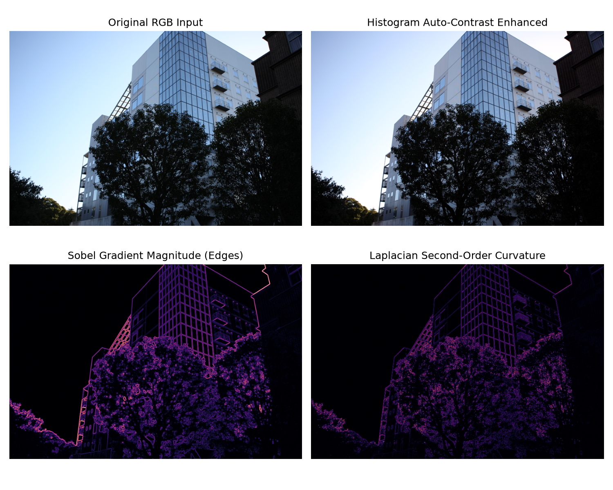

# Digital Image Processing & Computer Vision Algorithms

[](https://www.python.org/)
[](https://opencv.org/)
[](https://numpy.org/)
[](LICENSE)

A comprehensive computational laboratory implementing fundamental and advanced **Digital Image Processing (DIP)** algorithms in Python, OpenCV, Pillow, and NumPy across 110+ practical experiments.

---

## 🖼️ Visual Comparison & Spatial Filtering Demo

Below is the multi-stage filter transformation generated on benchmark photograph `image1.jpg`:



*Comparison panels demonstrating the original RGB frame, adaptive histogram contrast optimization, first-order Sobel directional gradient magnitudes, and isotropic Laplacian edge response.*

---

## 📌 Project Overview

This repository provides hands-on implementations of essential spatial-domain and frequency-domain image manipulation techniques:

### Covered Algorithmic Domains
1. **Contrast & Luminance Enhancement:**
   - Multi-channel intensity masking and thresholding.
   - Contrast Limited Adaptive Histogram Equalization (CLAHE) and auto-contrast stretching.
   - Gamma correction and non-linear dynamic range compression.
2. **Spatial Filtering & Edge Detection:**
   - First-order directional gradient estimation (Sobel $G_x, G_y$).
   - Second-order isotropic curvature (Laplacian $\nabla^2 f$).
   - Canny edge detection with non-maximum suppression and hysteresis thresholding.
3. **Morphological Image Transformations:**
   - Structuring element convolutions for Erosion, Dilation, Opening, and Closing.
   - Skeletonization and boundary isolation.
4. **Video Processing & Frame Sequences:**
   - Temporal frame extraction and motion difference tracking on video clips (`movie02.mp4`).

---

## 🚀 Quick Start

### 1. Installation
```bash
git clone https://github.com/javad-sajadi/image-Processing.git
cd image-Processing
pip install -r requirements.txt
```

### 2. Run the Enhancement & Edge Detection CLI
Processes sample images and generates a multi-panel visual comparison:
```bash
python image_enhancer.py --image image1.jpg
```

### 3. Interactive Jupyter Notebook
Explore the interactive 110+ image processing algorithms:
```bash
jupyter notebook image_processing_lab.ipynb
```

---

## 📁 Repository Structure

```
.
├── image_processing_lab.ipynb  # Comprehensive 110+ cell digital image processing laboratory
├── image_enhancer.py           # Production CLI tool for contrast enhancement and edge detection
├── enhanced_comparison.png     # Visual multi-filter comparison demonstration preview
├── image*.jpg / .jpeg          # Benchmark sample images for spatial filtering and testing
├── movie02.mp4                 # Video sequence benchmark for temporal frame processing
├── requirements.txt            # Python environment specifications
└── .gitignore                  # Clean Git ignore rules for cached artifacts and outputs
```

---

## 📜 Author & License
- **Author:** [Javad Sajadi](https://github.com/javad-sajadi)
- **License:** MIT License
